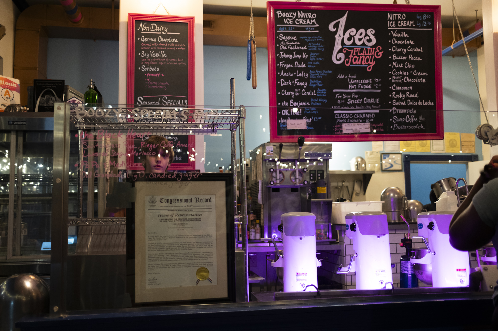

Shaw is a popular, centrally located neighborhood in St. Louis that is highly residential with a few restaurants, bars, and cafes interspersed. There's Ice's Plain & Fancy, a Nitro ice cream parlor, and Sasha's on Shaw, a wine and cheese bar, both of which give the neighborhood an upscale, family friendly feel. Down the center of the neighborhood is a boulevard with historic houses and mature tree canopy.

Along the western edge of the neighborhood is the Tower Grove Connector, a two-way, protected bike path that goes north to Vandeventer and will connect with the Brickline Greenway. I found this path to be delightful and a great example of a modern urban improvement.

