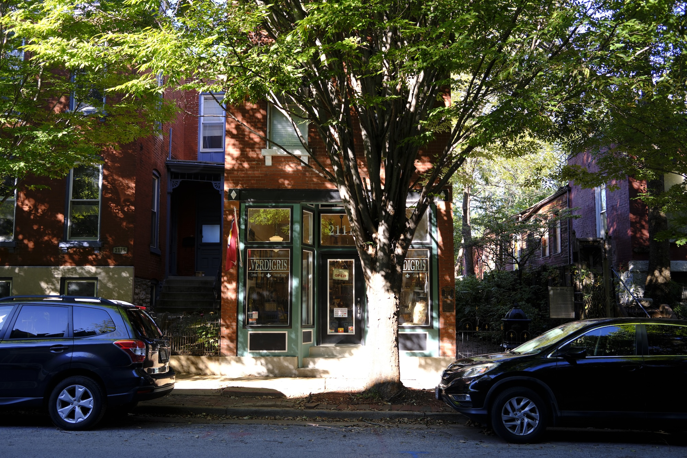
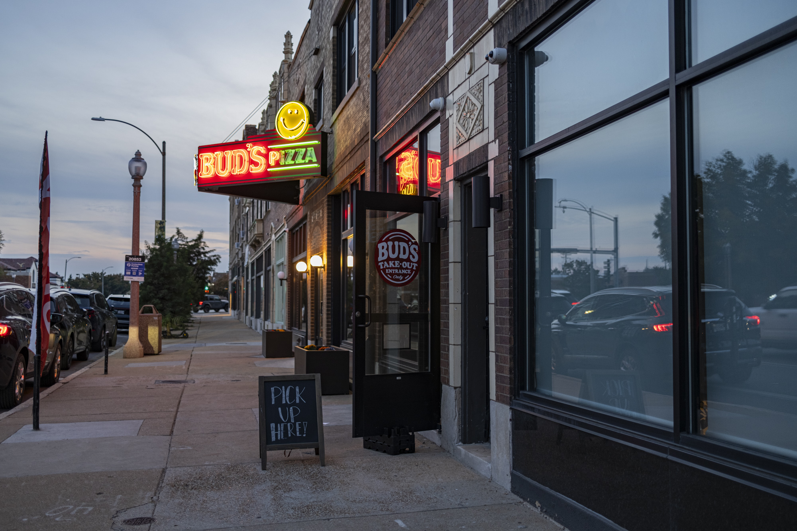

One of the first things you learn about St. Louis is there is no single main street to walk around and explore. Downtown has the Arch and the main business district, but isn't the place most people spend their time.

St. Louis is a city of many neighborhoods, and you'll find interesting clusters of shops and hidden gems all over the place, but it isn't always obvious to newcomers where to look.

I've been on a mission to discover all these walkable spots around the city and county. A few of them are obvious - The Grove and Cherokee Street are often mentioned by name - but some I just happened to stumble upon and slowly discover over time.

In this article, I'm using _walkable_ to mean an area that is interesting to walk around and explore, with plenty of shops, restaurants, and other businesses along it. I haven't factored in livability factors such as proximity to public transportation or groceries, though I plan to update this article in the future to include them.

To view the full combined neighborhood map, you can click here:

  <a class="pill-button" href="/neighborhoods/">
    
    Explore the Neighborhood Map
  </a>

## Overview

This is a map of all the walkable St. Louis streets you'll see throughout the article.

<figure class="street-map-figure">
  

</figure>

<small>The shaded areas denote the official neighborhoods, the lines are the highlighted streets.</small>

  
Legend

  <ul class="map-key-rows" aria-label="Legend">
    <li><strong>North City</strong> neighborhood</li>
    <li><strong>Central Corridor</strong> neighborhood</li>
    <li><strong>South City</strong> neighborhood</li>
    <li><strong>St. Louis County</strong> town</li>
    <li><strong>Walkable area</strong>: the street and the places along it</li>
  </ul>

## Central West End

<figure class="street-map-figure">
  

</figure>

Central West End is one of the most dense and urban neighborhoods outside of Downtown. Euclid is the main retail strip that runs through the neighborhood. The street is lined with large, opulent lanterns, giving the area a nice glow at night.

There are a good amount of late night food options and bars/clubs along Euclid. Tikka Tangy and Taste of Lebanon are a few of my favorite restaurants in the area. Updown, the arcade bar, is at the end of the line.

One of St. Louis's independent bookstores, [Left Bank Books](https://left-bank.com/), can be found here. There is also the World Chess Hall of Fame (with the world's largest chess piece), representing St. Louis as a world chess capital.

Just off Euclid, Maryland Plaza is a short street of restaurants and boutiques around a small square, running west toward the Chase Park Plaza.

Euclid is just a few short blocks from Forest Park, the proximity of which is a huge pro for the neighborhood. It's also a relatively bike-friendly area.

## Dogtown

<figure class="street-map-figure">
  

</figure>

Around the Clayton and Tamm intersection in Dogtown (technically the Clayton-Tamm neighborhood) is St. Louis's historical Irish neighborhood, where a St. Patrick's Day parade takes place each year. There are several Irish bars in this spot, like Seamus McDaniel's and The Pat Connolly Tavern.

## Tower Grove South

<figure class="street-map-figure">
  

</figure>

South Grand is the international restaurant row of St. Louis. Along this strip, you'll find a concentration of Vietnamese, Thai, Ethiopian, Persian, Lebanese, Indian, BBQ, and other varieties of food. Jay International Foods is also the spot to go for ingredients of the world. [MoKaBe's Coffeehouse](https://www.mokabescoffeehouse.com/) is a popular spot for coffee.

[Dunaway Books](https://www.dunawaybooks.com/) is a used book store with two floors that's really fun to browse.

The South Grand strip stops right at Tower Grove Park, which really adds to the walkability of this street, especially on a weekend during the farmers' market.

There's also a smaller strip along Morganford with a few places of interest, such as Amsterdam Tavern, the soccer bar, and Songbird.

## Shaw

<figure class="street-map-figure">
  

</figure>

Tucked between Tower Grove Park, the Missouri Botanical Garden, and Compton Hill Park is Shaw, a quiet tree-lined neighborhood full of historical Victorian homes. This is a great area to walk due to how quiet it is, and how much green space surrounds it.

There is not exactly one main street to walk along, but several businesses dotted throughout the neighborhood. You can get pastries at Damn Fine Hand Pies, coffee at Fiddlehead Fern Cafe, and liquid-nitrogen ice cream at Ice's Plain and Fancy.

Flora Place is a particularly pretty boulevard to walk along, showcasing many beautiful Victorian-era homes.

## Hampton & Macklind

<figure class="street-map-figure">
  

</figure>

Hampton Avenue around St. Louis Hills and Southampton has a very local neighborhood vibe. This is mostly a quiet area of the city with some shops, but I noticed a cluster of restaurants along the strip. There's [[jj-twigs-pizza-and-pub|J.J. Twigs]], a Chicago tavern-style pizza spot with the braided crust pizza, and the newly relocated [[moms-deli|Mom's Deli]], and [[salvage-yard|Salvage Yard]]. There's also [[bonos-pizzeria|Bono's Pizzeria]], the best Chicago deep dish I've had aside from Lou Malnati's, and more restaurants I have yet to try.

There's also another small strip nearby on Macklind with a Clementine's ice cream shop and a few bars and restaurants. The neighborhood around the shops is also fun to walk through.

## The Hill

<figure class="street-map-figure">
  

</figure>

The Hill is one of the most well-known neighborhoods of St. Louis. It was documented in [America's Last Little Italy: The Hill](https://www.youtube.com/watch?v=jvWa4euR-AA&t=1s) as one of the last Little Italys still around in America, and is the birthplace of the toasted ravioli, one of St. Louis's most sacred [[regional-foods|regional foods]].

St. Ambrose Church on Marconi is the heart of the neighborhood. All throughout the area, you'll see fire hydrants and crosswalks painted in the colors of the Italian flag. You can walk around and get Italian food, sandwiches, pizza, gelato, and more.

My two favorites are [[nicky-slices|Nicky Slices]] for Detroit-style pizza, and [[pizzeria-da-gloria|Pizzeria da Gloria]] for immaculate vibes and pizza.

## Bevo

<figure class="street-map-figure">
  

</figure>

In the '90s, St. Louis took in many refugees from the Bosnian War, and they settled in the neighborhood of Bevo Mill. This area became known as Little Bosnia, and Gravois became the main street. For many years, Bevo had the largest Bosnian population outside of Bosnia.

As far as restaurants in the area, Das Bevo is a biergarten in the Bevo windmill, which is the landmark of the neighborhood built by the Busch family back in the day. [[bevo-caffe-lounge|Bevo Caffe Lounge]] and [[zlatno-zito|Zlatno Zito]] are two spots serving traditional, authentic Balkan fare.

Although it has been thirty years since the Bosnian refugees settled in Bevo, there are still many signs of the population that built up the area. The Sebilj fountain replica stands as a monument for the region. Nowadays, much of [the Bosnian population has moved to South County areas like Affton](https://www.stlmag.com/The-Bosnian-Boom-in-South-County-St-Louis/).

## The Grove

<figure class="street-map-figure">
  

</figure>

One of the most distinctive and well-known streets in St. Louis is The Grove in Forest Park Southeast. It's the only neighborhood that welcomes you with a lit-up neon sign from both ends so there's no confusion about exactly where you are.

The Grove is most famous for being the city's LGBTQ+ nightlife district. On one end, you have Platypus bar and Urban Chestnut brewery, and on the other you have Handlebar, Atomic, and Rehab. In between are a few of my favorite restaurants in the city - Sultan, Grace Meat & Three, and The Gramophone.

## The Delmar Loop

<figure class="street-map-figure">
  

</figure>

In 2007, the Delmar Loop was named one of the ["10 Great Streets in America"](https://www.planning.org/greatplaces/streets/2007/delmarloop.htm) by the APA, due to the "sustained efforts of local business, government, and the community to achieve successful physical and economic revitalization".

There are a lot of interesting things to see on the street - the St. Louis Walk of Fame stars along the sidewalk, the Pageant and Delmar Hall for concerts, Moonrise Hotel and tons of neon signs. There's also the Loop Trolley which runs to Forest Park.

Notably, there is a concentration of very good Asian cuisine along Delmar, including my favorite ramen in the world, [[kishimoto-mendo|Kishimoto Mendo]]. The original Salt & Smoke BBQ and Fitz's are here, and Vintage Vinyl is a great spot to browse for vinyl records.

## Downtown

### Washington Avenue

<figure class="street-map-figure">
  

</figure>

Washington Avenue, often referred to as Wash Ave by locals, is one of the main streets of interest in Downtown. There are a number of restaurants close to the street that serve the business district during lunch hours, such as Sugarfire BBQ and Sauce on the Side, and even the Washington Ave Food Hall.

It's always worth mentioning City Museum, one of the most unique and interesting attractions in all of St. Louis, which is right along Wash Ave.

Being downtown, it's as walkable as it gets, and one of the areas most likely to have a lot of foot traffic during the day.

### Ballpark Village

<figure class="street-map-figure">
  

</figure>

Right next to Busch Stadium is Ballpark Village, a string of bars and restaurants surrounding a central entertainment district. It's a hub for people to hang out before a ball game or concert.

### Laclede's Landing

<figure class="street-map-figure">
  

</figure>

Laclede's Landing sits on the riverfront just north of the Arch, across the Eads Bridge. It's a few blocks of cobblestone streets and warehouses from the late 1800s, which are now restaurants and bars, and it's the remaining piece of the city's 19th-century commercial riverfront.

## Midtown

### Grand Center

<figure class="street-map-figure">
  

</figure>

Grand Center is the city's arts district, just north of Saint Louis University. The Fabulous Fox Theatre and Powell Hall, home of the St. Louis Symphony, are on Grand, and The Sheldon, the Pulitzer Arts Foundation and the Contemporary Art Museum are a short walk west on Washington.

### Midtown Alley

<figure class="street-map-figure">
  

</figure>

Midtown Alley is the stretch of Locust Street east of Grand that was once the city's automotive row. [[pappys|Pappy's Smokehouse]] is nearby.

## Cherokee Street

<figure class="street-map-figure">
  

</figure>

Cherokee St. is an arts district and commercial center in St. Louis. There are several restaurants, panaderias, and Mexican groceries along Cherokee. Although St. Louis does not have the most significant Hispanic neighborhood compared to other American cities, I'm glad there's a main area to go to get good Mexican food, bakery items, and other goods. The Cinco de Mayo festival in St. Louis also happens along Cherokee.

The eastern wing of Cherokee St. is a vintage shopping district known as the [antique row](https://cherokeeantiquerow.net/), with spots like Hammond's Antiques and Books and Elder's Antiques and a vinyl record store. This whole area is all small, family-owned storefronts with no chains and has a very eclectic, artistic vibe.

## Southtown

<figure class="street-map-figure">
  

</figure>

[[buds-pizza-and-beer|Bud's Pizza and Beer]] is one of my favorite spots for a classic slice in St. Louis, and every time I visited I noticed a couple of obelisks and signs denoting "Southtown". Due to my research on this site, I knew Southtown was not an official St. Louis neighborhood, so I was curious.

There used to be a Southtown Famous-Barr department store at Kingshighway & Chippewa that was demolished in the '90s that gave the area its name.

Now, there are new restaurants and bars filling up the space, such as the Golden Hoosier and Himalayan Yeti. It's honestly not the most walkable area of the city due to Kingshighway being such a busy street, but I can see the area getting more and more built up [as Garcia Properties is working on revitalizing it](https://www.stlmag.com/business/garcia-properties-south-kingshighway/).

## Soulard

<figure class="street-map-figure">
  

</figure>

I was hesitant to include Soulard in the list, because it breaks the mold by being a whole grid of bars as opposed to one main street. Nonetheless, the density of bars in the area makes it worth being included on the list of most walkable neighborhoods. The majority of businesses around the area are late night and bar focused, so you won't see much here along the lines of bookstores and cafes.

The Soulard Farmers market is one of the (if not _the_) oldest farmers' markets west of the Mississippi, continuously running since 1779.

The second largest Mardi Gras parade in the country happens in Soulard, second only to New Orleans.

I haven't spent much time in Soulard myself during its peak hours, but McGurk's has an excellent patio. When I have driven through Soulard during the afternoon, it has felt sleepy.

The north and south ends of Soulard have a different feel, with the north side being a bit more commercial and bustling, especially with the farmers market on a Saturday morning, and the south side being more residential and quiet.

## Lafayette Square

<figure class="street-map-figure">
  

</figure>

Lafayette Park is a beautiful park in St. Louis with a pavilion, grotto, lake, and bridge. Every one of the neighborhoods on this list that borders a park gets an edge, because you can also take a stroll around the park.

There are a few notable restaurants here. Park Avenue Coffee has a location here, and it's my absolute favorite coffee around the city (though not necessarily my favorite cafe - a few others like [[telva-at-the-ridge|Telva at the Ridge]], Noteworthy Cafe, etc. take the cake).

In addition to the park, there are also beautiful, historic mansions painted in vibrant colors that give this area an interesting, historic charm.

## Carondelet

<figure class="street-map-figure">
  

</figure>

Carondelet is an interesting part of St. Louis that was originally its own city that was annexed by St. Louis in 1870 (one of the last that ever would be!). It's a very old, very French village from back in the day.

I didn't really know there was anything in Carondelet aside from [[stacked-stl|Stacked]] (burgers) and Sugarwitch (ice cream sandwiches) but I recently discovered there's a whole strip of bars along the riverfront. Most of St. Louis is not along the riverfront as it's mostly been historically used for industry, so that's kind of interesting.

## DeMun

<figure class="street-map-figure">
  

</figure>

There's a small, chic strip in Clayton right to the west of Forest Park. Concordia Park runs right along DeMun, giving you a beautiful green park to amble along after dinner and/or ice cream along the strip.

In this area, you'll find Louie, an amazing spot to celebrate a birthday or anniversary, and Clementine's, the St. Louis ice cream classic. A location of Sasha's wine bar is also here, with the other being in Shaw. Many of these spots have outdoor patios, making it a lovely place to spend an evening.

DeMun is a small spot overall, but worth mentioning for how pleasant it is.

## Maplewood

<figure class="street-map-figure">
  

</figure>

In the 2010s, Maplewood was named one of [the top "hipster" neighborhoods in the U.S](https://www.stlmag.com/news/maplewood-named-one-of-top-hipster-cities-in-the-u-s/). There's a bit of a "Keep Maplewood Weird" vibe about the area, like a much smaller Portland or Austin.

There are two major breweries located in Maplewood - Side Project Brewing and Schlafly Bottleworks. There is also a cozy bookstore called The Book House and Strange Donuts, a local favorite donut shop. Bolyard's Meat & Provisions is a high quality butcher in the area.

Maplewood is a streetcar suburb with MetroLink access to the city, making it one of a few. The Treasure Aisles Antique Mall is nearby, as well as some restaurants like Locoz Tacos and the Japanese Sando Shack.

## Webster Groves

<figure class="street-map-figure">
  

</figure>

There are two main strips in Webster Groves. The Old Orchard district includes the famous James Beard award winning restaurant Balkan Treat Box and bookstore the Novel Neighbor.

On the east end of Webster, there's another main retail area with Telva at the Ridge (a cafe by the owners of Balkan Treat Box), Olive + Oak, and the Webster Groves Bookshop.

## Kirkwood

<figure class="street-map-figure">
  

</figure>

Downtown Kirkwood is a walkable area in Kirkwood, a wealthy suburb in the county of St. Louis. There's an Amtrak station in Kirkwood, making it more connected than most suburbs.

There are some restaurants along the main strip, like Napoli Kirkwood, Honey Bee's Biscuits, and Billy G's. There's also a Strange Donuts and Clementine's ice cream here, and notably there's The Minifig Shop, a Lego resale store.

And of course - you guessed it - Kirkwood has a farmers market.

## Conclusion

Did I miss a few spots? [Let me know](/about/#contact)! I'm still learning and exploring so there's bound to be some areas I missed.
