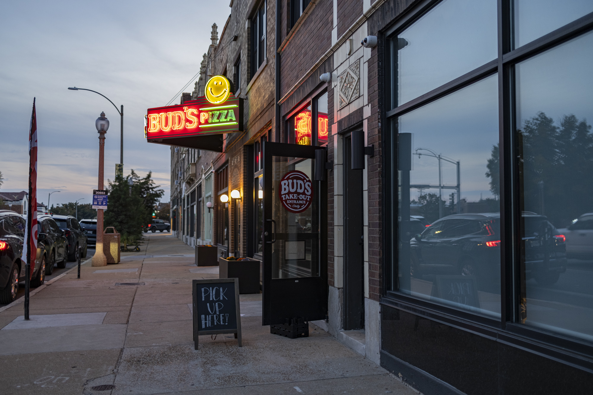

When I first moved to St. Louis, I quickly picked up the names of various places around the city - we'd go to Seamus McDaniel’s in Dogtown, or The Gramophone in The Grove. As I explored the city more and began mapping it for this project, I discovered there are several names you won't find on an official neighborhood map.

St. Louis has 79 official neighborhoods with clearly defined boundaries, but the way people refer to areas can be more casual. For this site, I was looking for a way to build a map that respects the official neighborhood boundaries while exposing the informal names people use as well.

Someone new to St. Louis might want to know what restaurants to check out in The Grove but not know to look in Forest Park Southeast yet. They might have been told to go check out Cherokee, which crosses multiple boundaries, or The Loop, which crosses the city-county line. And Dogtown isn't one neighborhood, but a group of neighborhoods south of Forest Park ([more on that below](#dogtown)).

The reason I made these changes on the map is so you can view the whole map and click on related groups together, for example on a Cherokee specific page, instead of having to click between four neighborhoods to see everything on Cherokee.

Here's a link to the full neighborhood map with restaurants, coffee shops, landmarks, museums, book and game stores, markets, parks, and write-ups. In the rest of this article, I'll explain some of the additions and variations I made to the map.

  <a class="pill-button" href="/neighborhoods/">
    
    Explore the Neighborhood Map
  </a>

## About the Map

<figure class="area-map-figure">
  

</figure>

  
Legend

  <ul class="map-key-rows" aria-label="Legend">
    <li><strong>North City</strong> neighborhood</li>
    <li><strong>Central Corridor</strong> neighborhood</li>
    <li><strong>South City</strong> neighborhood</li>
    <li><strong>St. Louis County</strong> town</li>
    <li><strong>Park</strong></li>
    <li><strong>District</strong>: a popular strip outlined by this site, not an official neighborhood boundary</li>
    <li>Official neighborhood inside a <strong>grouped set</strong></li>
  </ul>

### Mapped by one resident

A few other cities have had surveys to crowdsource opinions about neighborhood boundaries, such as The University of Chicago’s Chicago Neighborhood Project, [Chicago Neighborhoods, Mapped By Residents: Here’s Where Locals Think Official Boundaries Should Be](https://www.preservationchicago.org/chicago-neighborhoods-mapped-by-residents-heres-where-locals-think-official-boundaries-should-be/) and The New York Times [An Extremely Detailed Map of New York City Neighborhoods](https://www.nytimes.com/interactive/2023/upshot/extremely-detailed-nyc-neighborhood-map.html).

I think because St. Louis already has legally defined boundaries, no one has ever sent out a survey for vibes. The map on this site is just one person's attempt to create an informal map.

As a disclaimer, anything that isn't officially defined is a matter of opinion. I am not trying to take away from the identity of any neighborhood, but just document some of what I discovered over a few years of living in, exploring, and researching St. Louis. If there's anything I missed or got wrong, I'd love to learn about it and update the map and article!

### Defining the map

I used the map on [NextSTL](https://nextstl.com/2016/07/stl-400k-add-residents-st-louis-city/) to first define and color code north city, south city, and the central corridor for the map.

I also wanted to include some inner-ring suburbs, as they're a big part of the St. Louis experience. [[the-great-divorce|The Great Divorce]] prevented St. Louis from annexing its surrounding towns since the 1800s, so places like Maplewood, University City, and Clayton which might otherwise have been absorbed into the city are completely politically separate now. Nonetheless, visiting the shops and restaurants in those areas is a common experience for city residents.

On top of the official boundaries, I added two things:

- **Districts**: for anything that wasn't a full neighborhood or group of neighborhoods, such as a business strip, I overlaid a "district" boundary.
- **Grouped sets**: for areas where several official neighborhoods go by one name, I combined them into one region, with a dashed line between each official neighborhood.

## Districts

Some of the most popular places to visit in St. Louis are business districts that run along a major street. In some cases, they're contained entirely within a neighborhood's boundaries, and in other cases they straddle the line or cross between multiple neighborhoods. Here are a few that I documented.

On this site, each place in a district is labeled with both the official **neighborhood** it's in and the **district** it belongs to. For example, [[sultan|Sultan]] is in the neighborhood of Forest Park Southeast and the district of The Grove, and [[el-torito|Taqueria Hectorito]] is in Benton Park West and the Cherokee Street district.

The districts I've outlined here are loosely based on what I've observed, but St. Louis also has Community Improvement Districts (CIDs) that inform some of these decisions. The Grove, Cherokee Street, South Grand, and the city side of the Loop each have a CID, which are used to pay for cleanup, security, events, etc. in those areas.

[Here's the map](https://geoportal2.stlouis-mo.gov/portal/apps/mapviewer/index.html?webmap=65306ea748514677911c0c850caa4989) of the local taxing districts. Interestingly, a lot of the official CID boundaries overlap with my [[walkable-st-louis|Most Walkable Neighborhoods in St. Louis]] article, such as the intersection in Dogtown, Bevo, and Southtown.

### The Grove

[[the-grove|The Grove]], famous for being St. Louis's LGBTQ nightlife strip, is an example of a business district that is contained within a neighborhood. It runs down Manchester from Kingshighway to Vandeventer and is clearly defined by the two Grove signs on the east and west ends. The neighborhood is Forest Park Southeast.

This is also a neighborhood where the identity of the district informally extends to the whole area. Most of the homes in Forest Park Southeast are not in the Grove strip.

<figure class="area-map-figure">
  

</figure>

### South Grand

[[south-grand|South Grand]], known as St. Louis's international dining strip, is a business district that straddles the line between Tower Grove South and Tower Grove East on S. Grand Boulevard. Which side of the street a restaurant is on determines which neighborhood it appears in.

<figure class="area-map-figure">
  

</figure>

### Southtown

Along Kingshighway in South City there's a strip of restaurants owned by Garcia Properties, including Bud's Pizza, The Golden Hoosier, and Uncle Bill's Pancake House, in the area known as [[southtown|Southtown]]. There was once a department store there called Southtown Famous-Barr, which I assume is where the name came from.

<figure class="area-map-figure">
  

</figure>

### Cherokee Street

[[cherokee-street|Cherokee Street]] - part Hispanic community, part antique row - is a business district that runs through four neighborhoods: Gravois Park, Benton Park West, Benton Park, and Marine Villa. (To make things even more confusing, there's a sign along Cherokee that says "You are in Dutchtown." More on that in [Greater Dutchtown](#greater-dutchtown).)

<figure class="area-map-figure">
  

</figure>

### Delmar Loop

[[delmar-loop|The Delmar Loop]], a major tourist attraction in St. Louis and one of the "10 Great Streets in America" according to [The American Planning Association](https://www.planning.org/greatplaces/streets/2007/delmarloop.htm), is a business district that crosses over the city-county line. The west side is in University City, which is part of St. Louis County, and the east side is in Skinker DeBaliviere and West End, city neighborhoods.

Although the city-county line is a major division for the St. Louis region, the Loop shows that commerce easily crosses the border, connecting the two regions.

<figure class="area-map-figure">
  

</figure>

## Grouped Neighborhoods

In some instances, groups of neighborhoods are informally referred to by a single name with fuzzy boundaries. On the map, each of these is one region that encompasses the official neighborhoods, with a dashed boundary line between each one.

### Dogtown

[[dogtown|Dogtown]] is the neighborhood I named this article for, as it's the most obvious example of an informal neighborhood being formed of a grouped set of neighborhoods. There are a few community and merchant organizations all using the Dogtown name, so I've used the Dogtown United claim of Clayton-Tamm, Franz Park, Hi-Pointe, Cheltenham, and the eastern portion of Ellendale.

The city's list of Community Improvement Districts even includes a Dogtown CID, though it's marked inactive.

<figure class="area-map-figure">
  

</figure>

---

<small>Source: [Dogtown United](https://www.dogtownunited.org/dogtown): "The Dogtown area is located south of Forest Park and includes four neighborhoods of St. Louis: Clayton-Tamm, Franz Park, Hi-Pointe, Cheltenham, Ellendale (eastern portion)".</small>

<small>Source: [How Dogtown may have gotten its name](https://www.laduenews.com/community/st-patricks-day-st-louis-dogtown-history/article_1f8d23ba-e22f-11ee-918e-53892b858771.html): "If you know someone who lives in Clayton-Tamm, Franz Park, Hi-Pointe, Cheltenham or even part of Ellendale, they technically live in Dogtown, which has long been known as the Irish part of St. Louis."</small>

### Downtown

I've combined Downtown and Downtown West into a unified [[downtown|Downtown]] identity. Union Station (and the Aquarium), Energizer Park, and City Museum are all technically in Downtown West, but people just say they're going Downtown to see a soccer game or go to the aquarium.

The urban fabric is continuous across both sides of Downtown, so I wanted to group them both together to make it easier to find related things to do.

<figure class="area-map-figure">
  

</figure>

### Carondelet

[[carondelet|Carondelet]] and Patch form the southern tip of St. Louis city. Although a large portion of the restaurants and bars are actually located in Patch, the whole area is often informally called Carondelet. [Stacked Burger Bar](https://www.stackedstl.com/) refers to their Carondelet location despite it being in Patch, for example, and Sauce Magazine groups everything under [Carondelet/S. Broadway](https://community.saucemagazine.com/stlouis/LocationSearch?neighborhood=17352623&sortType=name&v=g).

The whole area used to be called Carondelet and was its own independent city separate from St. Louis until 1870. A century later in 1971 it was split into the two neighborhoods of Carondelet and Patch. This history has resulted in a lot of shared identity between the two neighborhoods.

The last 50 years have surely made the two areas distinct to the residents that live there, but for the purposes of my map I am grouping them together for all the restaurants, breweries, and bars.

<figure class="area-map-figure">
  

</figure>

---

<small>Source: [Patch, St. Louis on Wikipedia](https://en.wikipedia.org/wiki/Patch,_St._Louis): "The Patch neighborhood forms the southern tip of the Carondelet neighborhood".</small>

<small>Source: [St. Louis City Talk](https://www.stlouiscitytalk.com/posts/2010/01/patch-neighborhood): "First of all I always thought this area was Carondelet. Live and learn...this is Patch, the neighborhood with the coolest name of all 79."</small>

<small>Source: [St. Louis Patina](https://stlouispatina.com/patch-or-southern-carondelet/): "An eclectic area of South City, the official City of St. Louis neighborhood name for this area is Patch. However, many people I talk to simply consider this Carondelet, if the very southern tip of it."</small>

## Groupings Not on the Map

A couple of other groupings came up while I was mapping, but I left the neighborhoods independent on the map.

### Greater Dutchtown

Dutchtown is a neighborhood in South City. A few neighborhood organizations such as DutchtownSTL.org and Dutchtown South Community Corporation include the four neighborhoods of Gravois Park, Mount Pleasant, Marine Villa, and Dutchtown itself within their purview.

While walking along Cherokee Street, I noticed a sign that said "You are in Dutchtown", so whoever places the signs either agreed with Dutchtown informally reaching beyond its official bounds, or just made a mistake.

Personally, I haven't explored these neighborhoods too much yet, so it's easy for me to group them all together, but people who live there have stronger opinions. Since I had pushback, I just left all the neighborhoods on the map independent, but wanted to include it in this article for completeness.

<figure class="area-map-figure">
  

</figure>

---

<small>Source: [DutchtownSTL.org](https://dutchtownstl.org/about/): "The boundaries of what’s generally referred to as “Dutchtown” are quite fuzzy. The City of St. Louis defines some very specific boundaries. But signs around the neighborhood will tell you that “You Are In Dutchtown” when you are, in fact, in Gravois Park, Mount Pleasant, or Marine Villa. Here at DutchtownSTL, we approximate Dutchtown to be everything in between Cherokee Street or Chippewa Street to the north, Bates Street to the south, the Mississippi River to the east, and the Missouri Pacific railroad tracks to the west."</small>

<small>Source: [Dutchtown South Community Corporation](https://www.dutchtownsouth.org/place-based): "Dutchtown South Community Corporation supports four vibrant neighborhoods in South St. Louis City: Dutchtown, Gravois Park, Marine Villa, Mt. Pleasant."</small>

### Midtown

Between Midtown, Central West End, and Grand Center, places sometimes all get grouped into Midtown. For example, The Cortex is mostly in Central West End and the Fabulous Fox is in Grand Center, but I've heard both referred to as being in Midtown before.

## Known by Official Names

Many other popular neighborhoods in the city are known by their official name. The Hill, Soulard, Lafayette Square, Shaw, and Central West End are all official names. Some are shortened slightly, as people often call Bevo Mill simply Bevo, or Covenant Blu-Grand Center as just Grand Center.

Official names can change, too. Botanical Heights was called McRee Town until it was renamed as part of a redevelopment plan in the early 2000s.

---

<small>Source: [Missouri Historical Society, Gerard Connolly Collection](https://mohistory.mobiusconsortium.org/repositories/3/resources/621): McRee Town was renamed Botanical Heights as part of a rehabilitation plan.</small>

## St. Louis County

The different areas of the county are loosely grouped together as North County, West County, and South County, and often colloquially referred to with those names.

I included University City, Clayton, Maplewood, Richmond Heights, Affton, Kirkwood, and a few other towns on the map. If you're going on a St. Louis-style pizza tour, for example, you should go way north to [[pirrones|Pirrone's]] and way west to [[faraci|Faraci's]], both of which aren't located in the city.

I still have a lot of work to do to complete all the write-ups and exploration of the county.

## Conclusion

**In summary**:

- places like The Grove, Cherokee, and Delmar Loop aren't neighborhoods, so I outlined them as districts that can be searched by name
- places like Dogtown are not officially defined, but rather a group of neighborhoods under one colloquial name
- most other neighborhoods go by their official names, sometimes shortened
- the map extends into inner-ring suburbs in St. Louis County, because the culture of the region crosses the city-county line

People feel very strongly about the local identity of their neighborhoods, which is one of the awesome things about being in a city, and why I wanted to make this site. It has been a fun project for me as a transplant to map St. Louis and keep exploring and taking pictures and trying new food, and I hope it's useful or interesting to others as well. If I missed anything, let me know and I'll add it!

If you liked this article, you also might like [[walkable-st-louis|St. Louis's Most Walkable Neighborhoods]], a set of twenty-three walkable areas in St. Louis across the city and inner-ring suburbs, also with maps and major points of interest.

Once again, you can check out the neighborhood map right here:

  <a class="pill-button" href="/neighborhoods/">
    
    Explore the Neighborhood Map
  </a>

